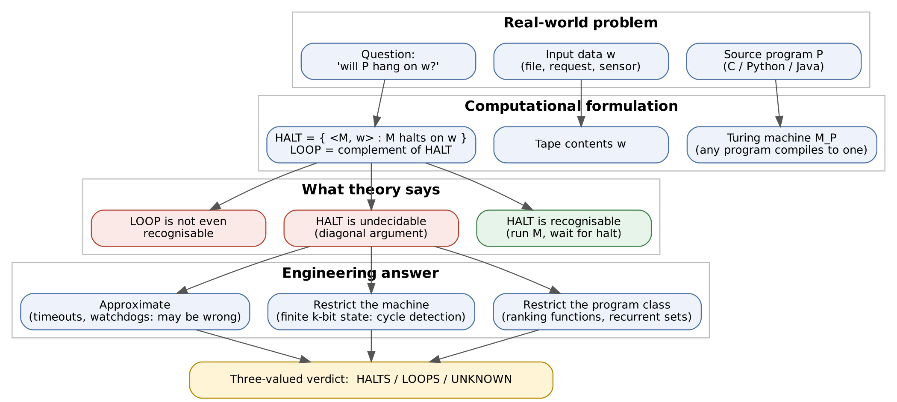
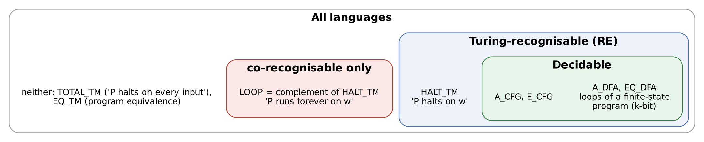
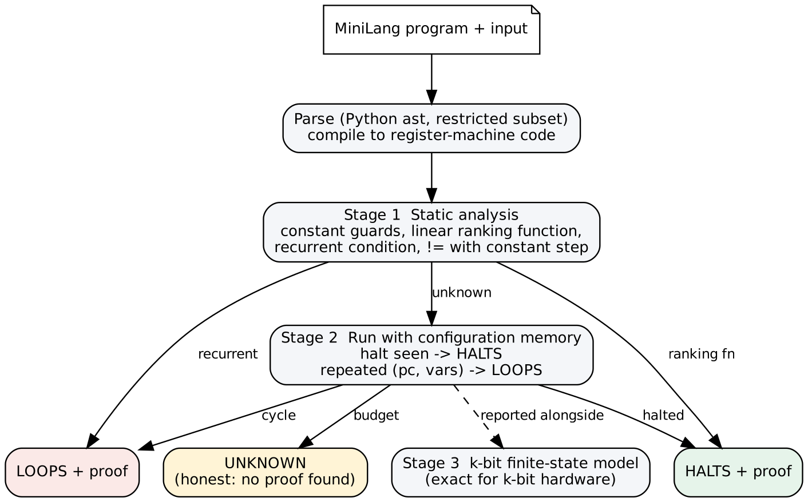

# LoopGuard: Infinite-Loop Detection and the Limits Set by Turing Machines

**Course:** 21CSC301T Formal Language and Automata, CLA-2, Assessment Task 4 (team)
**Team:** K R Vaishak (RA2411026050018) and Deepak V F (RA2411026050015), B.Tech AIML 'A', III year
**Faculty:** Dr. C. Gunasundari, SRM IST Tiruchirappalli
**Problem chosen:** (a) infinite-loop detection in software

> Turing machines are not used to build real systems, but they define what real
> systems can and cannot achieve.

## The decision problem

| Real world | Formal model |
|---|---|
| a program P (C, Python, ...) | a Turing machine M (every program compiles to one) |
| the input P is given | the tape contents w |
| "will P hang on this input?" | is ⟨M, w⟩ ∉ HALT, where HALT = { ⟨M, w⟩ : M halts on w } |
| "does P hang on *some* input?" | is M ∉ TOTAL, where TOTAL = { ⟨M⟩ : M halts on every input } |



* **HALT is Turing-recognisable.** Simulate M on w and accept if it halts.
* **HALT is undecidable.** Suppose some H decides it. Build D(⟨M⟩): run H on ⟨M, ⟨M⟩⟩ and do the
  opposite. Then D(⟨D⟩) halts ⇔ H says D(⟨D⟩) does not halt. That is a contradiction.
* So **LOOP = complement of HALT is not even recognisable**. If both HALT and its complement
  were recognisable, HALT would be decidable.
* **TOTAL** (and program equivalence EQ_TM) is neither recognisable nor
  co-recognisable. Rice's theorem says every non-trivial property of what a
  program computes is undecidable.



**Conclusion:** no tool can take an arbitrary program and input and always say
correctly whether it loops. Any tool that claims to is wrong on some D. This repo
checks that against four real candidate deciders:

```
candidate H   what it does                              H says   D really
H_optimist    says every program halts                  halts    runs forever  H WRONG
H_pessimist   says every program loops                  loops    halts         H WRONG
H_syntax      looks for 'while True' in the source      loops    halts         H WRONG
H_timeout     runs P for 1000 steps                     halts    runs forever  H WRONG
```

## The restricted-case solution: LoopGuard

LoopGuard does not claim the impossible. It gives a **three-valued** answer, and
both HALTS and LOOPS come with a proof:



| technique | why it is sound | decidable because |
|---|---|---|
| linear ranking function r (e.g. r = n − i for `while i < n: i += 1`) | r is an integer > 0 while looping and drops ≥ 1 per pass | we only accept loops where r is linear and every update is a constant step |
| recurrent condition (`while i > 0: i += 1` with i = 10 on entry) | the guard can never become false | same restriction |
| `!=` guard with constant step (`x = 7; while x != 0: x -= 2`) | x ≡ 1 (mod 2) forever, so it never hits 0 | arithmetic on the entry value |
| run + remember configurations (pc, variables) | the machine is deterministic, so a repeated configuration repeats forever | finite only for some programs |
| k-bit finite-state model | at most (#pc)·2^(k·#vars) configurations, so a repeat *must* happen | the program becomes a finite automaton |

Programs are written in **MiniLang**: Python syntax with `=`, `+=`, `while`,
`if/else`, `break` and integer arithmetic. They are compiled into a small
register-machine code (`set`, `jf`, `jmp`, `halt`), and a configuration of that
machine plays the role of a TM's instantaneous description.

### Results on the benchmark (`python -m loopguard.cli benchmark`)

| program | truth | static | run + cycle | 8-bit | timeout only | **LoopGuard** |
|---|---|---|---|---|---|---|
| countdown | halts | HALTS | halts | halts | halts | **HALTS** |
| sum_to_n | halts | HALTS | halts | halts | halts | **HALTS** |
| nested | halts | HALTS | halts | halts | halts | **HALTS** |
| busy_wait | halts | HALTS | ? | halts | *loops?* ✗ | **HALTS** |
| server_loop | loops | LOOPS | ? | loops | loops? | **LOOPS** |
| retry_with_break | halts | UNKNOWN | halts | halts | halts | **HALTS** |
| wrong_direction | loops | LOOPS | ? | *halts* | loops? | **LOOPS** |
| forgot_update | loops | LOOPS | ? | loops | loops? | **LOOPS** |
| swap_forever | loops | UNKNOWN | loops | loops | loops? | **LOOPS** |
| skip_zero | loops | LOOPS | ? | loops | loops? | **LOOPS** |
| doubling | loops | UNKNOWN | ? | *halts* | loops? | UNKNOWN |
| gcd | halts | UNKNOWN | halts | halts | halts | **HALTS** |
| gcd_zero_bug | loops | UNKNOWN | loops | loops | loops? | **LOOPS** |
| collatz_27 | halts | UNKNOWN | halts | halts | halts | **HALTS** |
| collatz_0 | loops | UNKNOWN | ? | loops | loops? | UNKNOWN |

**13 of 15 decided, 0 wrong.** The two UNKNOWNs are honest. `doubling` really loops
on mathematical integers, but no repeat or ranking argument applies. On 8-bit
hardware it *halts*, because 128 × 2 overflows to 0. The same thing happens with
`wrong_direction`. A loop's behaviour depends on the machine model, which is why
"assumptions" matter.

## Run it

```bash
python -m loopguard.cli all                  # theory demo + benchmark
python -m loopguard.cli explain gcd_zero_bug # one program, every stage explained
python -m loopguard.cli my_program.py        # analyse your own MiniLang file
python -m pytest -q                          # 23 tests, incl. a soundness sweep over 2 400 programs
python tools/make_diagrams.py                # rebuild diagrams (needs Graphviz)
```

Pure Python 3.9+. `pytest` and Graphviz are optional.

## What this means for real systems

* Industrial tools (compiler warnings, Infer, Terminator, AProVE, KLEE) all work
  like LoopGuard. They are sound on a restricted class and say "don't know" outside it.
* Timeouts and watchdog timers are necessary in production, but they are
  *policies*, not decisions. A long job killed at 30 s may have been about to finish.
* Embedded systems really are finite-state, so exact loop detection is possible in
  principle. In practice it is limited by the size of the state space, not by
  undecidability.
* Design for analysability. Loops with an obvious decreasing counter, bounded
  retries and explicit `break` conditions are the ones a tool can prove correct.

## Layout

```
loopguard/machine.py    MiniLang parser, register-machine compiler, interpreter, k-bit mode
loopguard/analyzer.py   static analysis (ranking / recurrent / != step) + full pipeline
loopguard/programs.py   benchmark with hand-checked ground truth
loopguard/diagonal.py   executable diagonal argument against four candidate deciders
loopguard/tm.py         Turing-machine simulator with ID-repetition detection
loopguard/cli.py        terminal demo
tests/                  validation suite
docs/diagrams/          problem mapping, decidability classes, pipeline, TM diagrams
```

See [CONTRIBUTIONS.md](CONTRIBUTIONS.md) for who did what.
